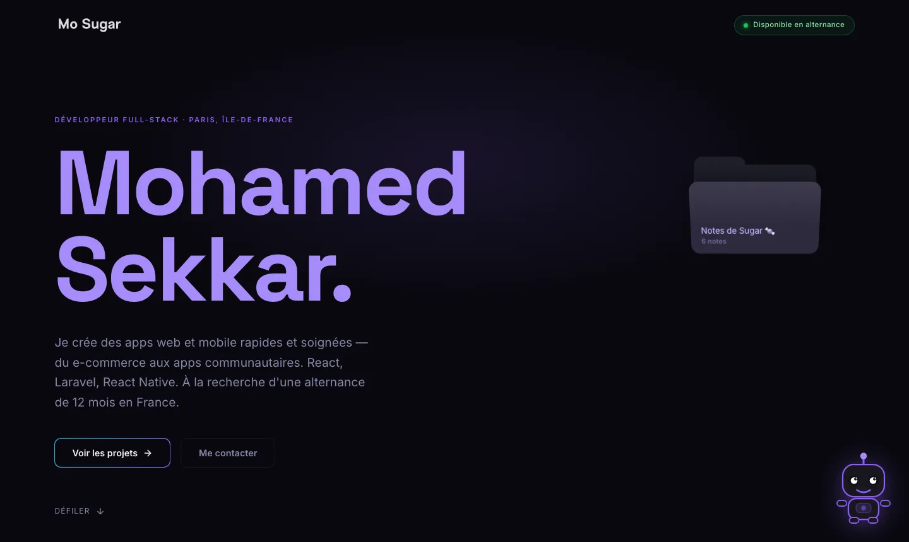
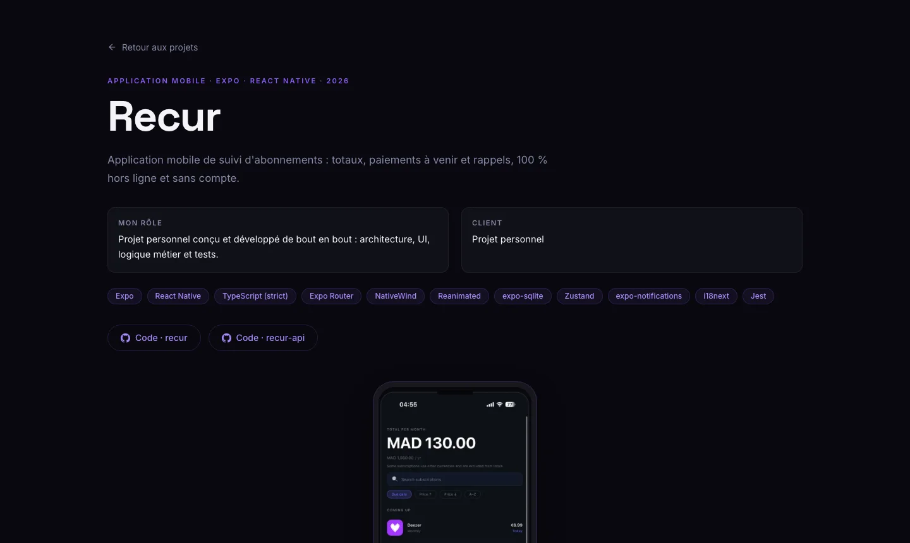

<div align="center">

# Mohamed Sekkar — Portfolio

**Full Stack Developer · Java / Spring Boot · React / React Native · Laravel**

[](https://www.mohamedsekkar.com)
[](https://github.com/Mosugar/portfolio/actions/workflows/ci.yml)




</div>

---

## About

My personal portfolio, where I present my experience, my skills and the projects I've built.
I'm currently studying for the **Concepteur Développeur d'Applications** professional title (Bac+3) at SCHOLIA and looking for a **12-month work-study position (alternance)** in Île-de-France.

👉 **Live:** [www.mohamedsekkar.com](https://www.mohamedsekkar.com)

## Features

- **Sections:** Home, About, Skills, Journey (education & experience), Resume, Projects, Contact
- **Case studies** — one page per project (`/projets/:slug`): context, role, approach, UX choices, screenshots, links to the live site and the code
- **Sugar, the guide** — a small robot that offers an optional guided tour of the page
- **FR / EN** — full content translated, language remembered per visitor, no library
- **Interactive details** — physics-driven folder (Matter.js), spotlight cards, holographic profile card, custom cursor, bubble sounds on skill hover (Web Audio API)
- **Contact form** via Formspree, and the resume available to download
- **SEO** — prerendered HTML per project with its own Open Graph image, sitemap, JSON-LD structured data
- **Accessibility** — keyboard focus styles, skip link, `prefers-reduced-motion` respected, labelled icon links
- **Responsive** — checked at 375 px and 1440 px



## Tech stack

| Category | Library / Tool |
|---|---|
| Framework | React 19 |
| Build tool | Vite 7 |
| Language | JavaScript (JSX) |
| Styling | Tailwind CSS 4, CSS Modules |
| Animations | Framer Motion, GSAP + ScrollTrigger |
| Physics | Matter.js |
| Icons | Lucide React |
| Forms | Formspree (`@formspree/react`) |
| Routing | Tiny custom router (History API) |
| i18n | React Context — custom, FR / EN |
| Tooling | ESLint, Playwright (screenshots), GitHub Actions, Dependabot |
| Hosting | Vercel |

## Getting started

Requirements: Node.js 22 or later.

```bash
git clone https://github.com/Mosugar/portfolio.git
cd portfolio
npm install
npm run dev
```

Then open [http://localhost:5173](http://localhost:5173).

### Scripts

| Command | What it does |
|---|---|
| `npm run dev` | Development server |
| `npm run lint` | ESLint |
| `npm run build` | Production build, then `scripts/prerender.mjs` writes one HTML page per project (with its meta tags) and updates the sitemap |
| `npm run preview` | Serves the production build locally |
| `node scripts/capture.mjs [slug…]` | Takes the project screenshots from the live sites (WebP, needs `cwebp`) |
| `node scripts/og-images.mjs` | Builds each project's 1200×630 social preview image |

Every pull request runs lint and build in GitHub Actions and gets a Vercel preview.

## Project structure

```
src/
  components/   # Page sections and reusable components
  context/      # Language context
  data/         # Projects, skills and computed stats (single source of truth)
  hooks/        # Custom hooks
  i18n/         # FR / EN translations
  pages/        # Case study page
  router/       # Minimal client-side router
  styles/       # Global and component styles
scripts/        # Prerender, screenshots and social images
public/         # Static assets (fonts, images, resume)
docs/           # README screenshots
```

## Contact

- Portfolio: [mohamedsekkar.com](https://www.mohamedsekkar.com)
- LinkedIn: [linkedin.com/in/mohamedsekkar](https://linkedin.com/in/mohamedsekkar)
- Behance: [behance.net/mohamed_sekkar](https://www.behance.net/mohamed_sekkar)
- Email: sekkarmohamedd@gmail.com

---

© Mohamed Sekkar. The code is visible for reference. Personal content (photos, resume, texts and design) may not be reused without permission.
